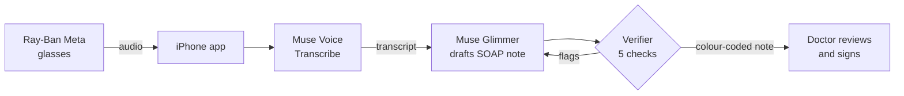

# KORA Scribe


**Hands-free clinical scribe for public-sector doctors in Mexico.** *(Work in progress: this README describes the design; see Status for what is built so far.)*

Ray-Ban Meta glasses capture the consultation, Muse Voice Transcribe turns it into text, Muse Glimmer drafts a SOAP note, and a verifier agent checks every line against the transcript before the doctor reviews and signs.

> **Documentation, not decisions.** KORA Scribe never diagnoses, recommends treatment, or gives medical advice. It only structures what the clinician and patient actually said, and the clinician signs every note.

Built for the **Meta Global AI Developer Hackathon 2026** (Startup Track, *Build for Your World*).

---

## The problem

In Mexico's public health system, a primary-care doctor sees a patient every 15 to 20 minutes and spends a large share of each visit typing into the record instead of looking at the patient. Notes end up short, late, or copied from the previous visit.

General-purpose AI scribes make this worse in a quieter way: they produce notes that *look* complete but quietly add things nobody said, such as an inferred diagnosis, a rounded number, or a medication the patient mentioned treated as if the doctor prescribed it. A note that reads well but is not grounded is more dangerous than a short one.

## What KORA Scribe does

1. **Capture.** The doctor wears Ray-Ban Meta glasses. Audio is captured hands-free on the paired iPhone.
2. **Transcribe.** Muse Voice Transcribe produces a timestamped transcript.
3. **Draft.** Muse Glimmer (open weights, self-hosted) drafts a structured SOAP note. Every line must cite the transcript segment it comes from.
4. **Verify.** Checks that the model cannot skip review every line, and flag where the transcript itself may be missing speech (see below).
5. **Review and sign.** The doctor sees each line colour-coded, edits what needs editing, and signs. Nothing is final until a human signs.



Prompts and clinical output are in Spanish on purpose: the consultations and the notes are for Mexican clinicians. Code and documentation are in English.

## Verification: five checks

Following the verification-layer pattern from Meta's hackathon agent workshops, the checks run outside the model's control, at the moment the note tries to move forward.

| # | Check | How | What it catches |
|---|---|---|---|
| 1 | **Verbatim citation** | Code | A line citing words that do not appear in the transcript |
| 2 | **Source** | Code | Subjective lines may cite the patient; Objective, Assessment and Plan lines must cite the clinician. Catches a medication the patient *mentioned* written as if the doctor *prescribed* it |
| 3 | **Scope** | Model (Muse Spark Open) | A line that says more than its citation, e.g. "patient reports chest pain" upgraded to "angina" |
| 4 | **Coverage** | Checklist per visit type | A note that looks complete but is missing vitals, allergies, or the plan |
| 5 | **Lost audio** | Code | A clinician question with no recorded answer, or a long stretch with no transcribed speech: signs that the patient said something the transcript never captured |

Each line ends up as one of:
- ✅ **Supported** by what was said
- 🟡 **Needs a look**: off-topic content, a doubtful medical term (a slip while dictating or a transcription error), or mixed sources
- 🔴 **Unsupported**: a number, finding or plan that the cited turns do not contain

Lines that cite only the patient are tagged 💬 *patient-reported*, so the clinician can tell what was measured from what was told.

## Review and sign

A local page (`review/index.html`, served by `scripts/review_server.py`) puts the note and the transcript side by side:

- Click a line to highlight the transcript turns it cites; press ▶ to hear exactly those turns.
- Lost-audio warnings sit in the transcript where the speech went missing, with a button to play that stretch.
- The clinician can correct, accept, remove or add lines. Every change is kept next to what the model proposed.
- **Signing is blocked** until every 🔴 line has been decided and every lost-audio warning has been reviewed.
- The signed record (`<case>.signed.json`) holds the final note, where each line came from (model, corrected by the clinician, added by the clinician), the full audit of changes, and SHA-256 hashes of the note and of the transcript it was checked against.

```bash
python scripts/run_pipeline.py audio/consulta.wav    # transcribe, draft, verify
python scripts/review_server.py audio/consulta       # review and sign at http://localhost:8770
```

Everything runs on the clinician's machine; the page talks only to the local server.

## Meta AI tooling

| Component | Role |
|---|---|
| Ray-Ban Meta glasses + Wearables Device Access Toolkit | Hands-free audio capture |
| Muse Voice Transcribe (Meta Model API) | Speech to text |
| Muse Glimmer (open weights, on Modal GPU) | SOAP note drafting |
| Muse Spark Open (open weights, on Baseten) | Scope check in the verifier |
| Muse Code | Development |

Note generation and verification run on open-weight models. Mexico's health-record regulation (NOM-024) pushes toward data sovereignty, and clinical notes are among the most sensitive records a system holds, so a deployment path that does not depend on a closed hosted API matters.

## Data policy

- **Synthetic data only.** Every consultation in this repository and in the demo is fictional and was written for testing. No real patient data is used, stored, or sent to any API.
- No credentials in the repository. API keys live in a local `.env` file, which is git-ignored.

## Built during the hackathon vs. pre-existing

Judges must be able to see what is new, so this is explicit.

**Built during the hackathon (Oct 27 to Nov 4, 2026):** all the code in this repository. Work started on October 27; the commit history shows what was added and when, and the Status section below shows what is done and what is still in progress.

**Pre-existing (not in this repository):** the author's electronic health record, already in use in public clinics in Mexico. None of its code is included here or presented as hackathon work. Exporting signed notes to it through a standard interface (FHIR) is planned after the hackathon.

## Status

🚧 In progress. This README is the specification and will be updated as each part ships.

- [x] Transcription test with Muse Voice Transcribe: Spanish, speaker diarization, turn IDs and timestamps (`scripts/transcribe_file.py`)
- [x] Glasses audio capture on iPhone (`ios/`): records through the Ray-Ban Meta microphone over Bluetooth, straight to 16 kHz mono WAV
- [x] SOAP drafting with citations, on Muse Spark Open (`scripts/draft_note.py`)
- [ ] SOAP drafting with Muse Glimmer
- [x] Verifier: citation, source, scope, coverage, lost audio (`scripts/verify_note.py`)
- [x] One-command pipeline: audio to verified note (`scripts/run_pipeline.py`)
- [x] Review-and-sign interface: cited turns, audio playback per turn, lost-audio warnings, edits with audit trail, blocked signature (`review/`, `scripts/review_server.py`)
- [ ] Synthetic test consultations with expected facts
- [ ] Demo video

### Early findings

- Diarization separated clinician and patient correctly on every turn of a synthetic 104-second consultation.
- Keyword biasing fixed clinical terms that were first misheard ("me torcí" had come out as "me siento bien"; "maléolo" now has its accent).
- The verifier flagged "pulso medio" as a doubtful term. Listening back, the clinician had actually said "pulso medio" instead of "pulso pedio": a slip while dictating, not a transcription error. Catching the clinician's own slips is useful too, and is another reason the clinician reviews before signing.
- The same audio can produce slightly different transcripts on different runs, so the stored transcript is the single reference the note is verified against.
- The Ray-Ban Meta microphone over Bluetooth was good enough for clinical dictation: in a 69-second dictation with the iPhone 2 to 3 metres away and locked halfway through, every drug and term came through correctly ("metformina", "losartán", "monofilamento", "pulso pedio", "hemoglobina glucosilada"), and so did the spoken correction of a blood pressure reading.
- The first glasses test lost everything after 31 seconds because the iPhone auto-locked and iOS suspended the app. The capture app now keeps the screen awake, records in the background, and warns the clinician if a call or another app interrupts the recording.
- With the glasses, the patient's voice one metre away is much weaker than the wearer's. In a synthetic consultation the chief complaint ("me torcí el tobillo") never reached the transcript, and the note still passed every line check: a verifier can only check a note against what was transcribed. This led to the fifth check, which flags unanswered clinician questions and long silences so the clinician knows what to confirm, and to a simple practice that fixes it at the source: the clinician recaps the history aloud before examining.
- A model-based check is not deterministic: the same line ("Temperatura 36.8 °C") passed on one run and was flagged on another. Numbers, sources and lost audio are therefore checked in code; the model is a second layer.
- Listening back is part of the review. The transcript had "poquito pero con gelada" (unintelligible); the draft papered over it as "pudo caminar poquito pero con dificultad", and the scope check flagged that line 🔴. Playing the two cited turns from the review page, the patient's word was clearly "cojeando". The clinician corrected the line in seconds, and the signed record keeps both versions.
- Errors in the transcript itself cannot be caught by checking the note against the transcript. That is why the clinician's review and signature stay mandatory.

## Author

**Dante Alejandro Ramírez Robles**, practicing physician in Mexico's public health system, founder and solo developer of a health-tech startup building an electronic health record for public clinics.

## License

MIT. See [LICENSE](LICENSE).
